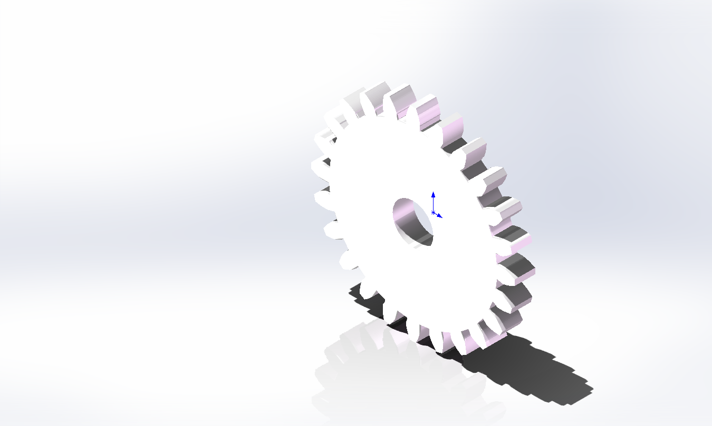
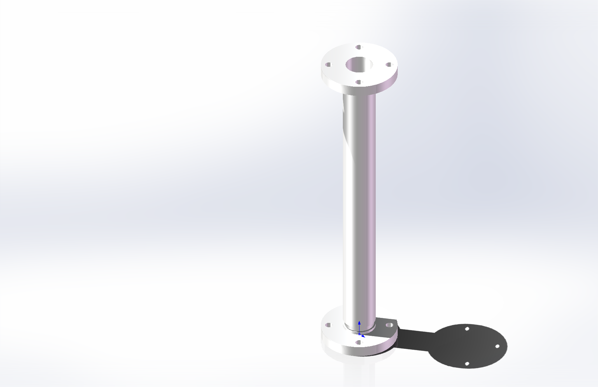
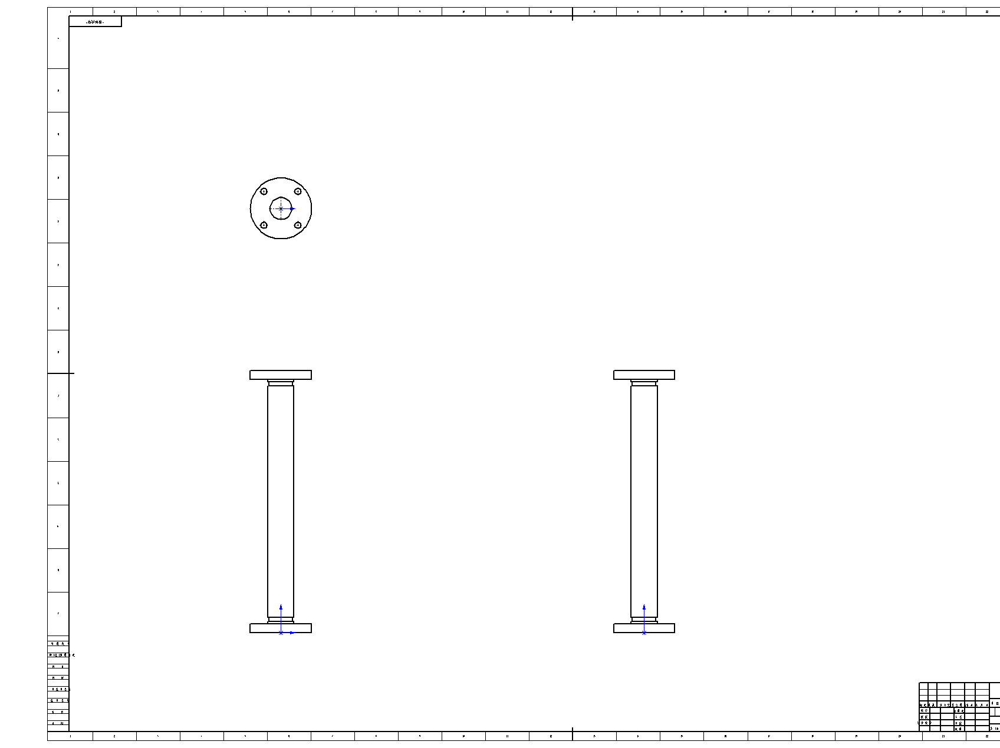

# swagent

An MCP server that lets an AI agent drive a **local SOLIDWORKS** installation over COM:
sketch, extrude, revolve, drill, pattern, mirror, shell, chamfer, build drawings, save,
export and screenshot — with **a measured number returned for every modelling call**.

Built because the existing SolidWorks MCP servers assume SOLIDWORKS is already running,
target versions newer than 2022, and give you no way to tell a silent no-op from a
successful feature.

```
MCP client  ──stdio JSON-RPC──▶  swagent  ──comtypes/COM──▶  SLDWORKS.exe 2022
                                    │
                                    └─ every call: measure volume, abort if unchanged
```

- Protocol: MCP over stdio, JSON-RPC 2.0, newline delimited
- Tools: 39 (see [docs/TOOLS.md](docs/TOOLS.md) for the per-tool verification status)
- Engine: [comtypes](https://pypi.org/project/comtypes/) bound directly to `sldworks.tlb`
- No other third-party dependencies. Pure-Python BMP→PNG so screenshots need no Pillow.

| 24-tooth involute gear | Propeller shaft, 8 bolt holes | Drawing sheet |
| --- | --- | --- |
|  |  |  |

Both parts are modelled entirely through this server: one tooth plus a circular pattern for the
gear, extrude-drill-revolve for the shaft. Their volumes are checked against the closed-form
value in the examples, to three decimals.

## Status (honest)

Tested on **one** machine: Windows 11, SOLIDWORKS **2022 SP05**, Chinese UI, network
(SolidNetWork) licence. That is where the numbers below come from. Everything else is
untested — treat it as "works in principle, verify on yours".

| Capability | Evidence |
| --- | --- |
| Box 100×60×20 | `volume_mm3 = 120000` |
| Through hole ⌀12 | removed `2261.947` = π·6²·20 |
| Blind hole, `through_next` | removed `2261.947` — one wall only |
| Counterbore ⌀16×6 + ⌀8 | removed `1910.088` = π·4²·20 + π·8²·6 − π·4²·6 |
| Revolve (shaft) | `1010273.366 mm³`, equals the analytic value exactly |
| 24-tooth involute gear | `62484.6 mm³` vs analytic `62644.8` (−0.256 %, chordal tips) |
| Full propeller shaft, 8 bolt holes | `985643.279 mm³` vs analytic `985643.279` (**−0.000 %**) |
| Assembly, drawing sheet, configurations | 2 components; 4-view A0 sheet; family table 15000/30000 mm³ |

## Requirements

- Windows, SOLIDWORKS **2022 or later** installed (the type library is found through the
  registry, so no path configuration is needed)
- Python 3.10+ and `pip install comtypes`
- SolidWorks must be **licensed and launchable** by the same user account that runs the server

Two environment quirks we hit, which you may or may not have:

- on that machine the VBA 7.1 engine only initialises for an **elevated** process, and an
  unelevated SolidWorks then reports success while writing **0 bytes**. If saves behave
  strangely, run the host and SOLIDWORKS both as administrator.
- the licence was a campus **network licence**, unreachable without VPN. `sw_status` probes
  the licence before launching and fails with a readable error instead of hanging on a dialog.

## Install

```bat
git clone https://github.com/<your-account>/swagent.git
cd swagent
python -m venv .venv
.venv\Scripts\pip install -e .
```

Check it without touching SOLIDWORKS:

```bat
.venv\Scripts\python -m swagent --version
.venv\Scripts\python -m swagent --list-tools
.venv\Scripts\python tests\test_offline.py       :: 15 checks, no SolidWorks needed
.venv\Scripts\python tests\probe_protocol.py     :: real stdio handshake
```

## Wire it into an MCP client

```yaml
- id: mcp-solidworks
  name: '@deepseek-ai/dsh-mcp-client'        # or any MCP stdio client
  config:
    serverName: solidworks
    transport: stdio
    command: 'D:\path\to\swagent\.venv\Scripts\python.exe'
    args: ['-m', 'swagent']
    toolCallTimeoutMs: 600000
```

For Claude Desktop the same thing in `claude_desktop_config.json`:

```json
{
  "mcpServers": {
    "solidworks": {
      "command": "D:\\path\\to\\swagent\\.venv\\Scripts\\python.exe",
      "args": ["-m", "swagent"]
    }
  }
}
```

## Tools in one screen

`sw_status` · `sw_new_part` · `sw_open_part` · `sw_close_part` · `sw_list_features` ·
`sw_mass_properties` · `sw_rebuild` · `sw_view` · `sw_screenshot` · `sw_save` ·
`sw_export` · `sw_set_dimension` · `sw_add_box` · `sw_add_cylinder` · `sw_add_profile` ·
`sw_cut_hole` · `sw_cut_pocket` · `sw_counterbore` · `sw_gear` · `sw_fillet` ·
`sw_chamfer` · `sw_shell` · `sw_revolve` · `sw_circular_pattern` · `sw_linear_pattern` ·
`sw_mirror` · `sw_offset_plane` · `sw_delete_feature` · `sw_new_assembly` ·
`sw_add_component` · `sw_list_components` · `sw_add_mate` · `sw_new_drawing` ·
`sw_add_drawing_view` · `sw_standard_views` · `sw_drawing_annotations` ·
`sw_add_configuration` · `sw_activate_configuration` · `sw_family_table`

Full schemas: `python -m swagent --list-tools`, or read `swagent/tools.py`.

## Design notes

1. **Measure, don't trust.** Every modelling call takes the volume before and after and
   raises `cut_failed` / `extrude_failed` if it did not move. This is how a silently
   ignored `FeatureExtrusion2` was caught; the API had returned an object and built nothing.
2. **Write whitelist.** `resolve_output()` only allows the package directory and its parent;
   extend it with `SWAGENT_OUTPUT_ROOTS`. Requests outside it fail with `path_not_allowed`.
3. **Errors are objects, not tracebacks**: `{"code": "not_connected", "message": …,
   "hint": "Connect to the VPN that serves the licence server, then call sw_status again."}`

## Configuration

| Variable | Meaning | Default |
| --- | --- | --- |
| `SWAGENT_SLDWORKS_TLB` | path to `sldworks.tlb` | found via registry, then glob |
| `SWAGENT_OUTPUT_ROOTS` | extra writable folders (`;` separated) | package dir + parent |
| `SWAGENT_PART_TEMPLATE` | `.prtdot` | globs `C:\ProgramData\SOLIDWORKS\*\templates` |
| `SWAGENT_ASSEMBLY_TEMPLATE` | `.asmdot` | same |
| `SWAGENT_DRAWING_TEMPLATE` | `.drwdot` | same |

## Known limits

- Argument counts were measured against the 2022 typelib. Another SolidWorks year may add or
  drop a parameter and produce `TypeError: call takes exactly N arguments`; see
  [docs/PITFALLS.md](docs/PITFALLS.md) for how to re-measure in ten minutes.
- `sw_add_mate`, `sw_linear_pattern`, `sw_drawing_annotations` are wired but not verified.
- Single-view drawing API (`CreateDrawViewFromModelView3`) returns nothing on 2022 SP05;
  only the four-view `Create3rdAngleViews2` route is used.
- Holes must be positioned on **extruded** faces. On a revolved body the face sketch frame is
  not the part origin, so model "extrude the flange → drill → revolve the body" instead.
- No surface modelling, sheet metal, weldments, simulation or CAM.

## Examples

`examples/gear.py` and `examples/shaft.py` rebuild the two parts in this repo's screenshots,
both checked against an analytic volume. Run them with an elevated interpreter:

```bat
.venv\Scripts\python examples\shaft.py
```

## License

MIT. SolidWorks is a trademark of Dassault Systèmes; this project is unaffiliated and only
talks to a licensed installation you already own.

中文说明见 [docs/中文说明.md](docs/中文说明.md)。
